# LLD Practice Platform: Design

A learner picks a Low-Level Design problem, thinks through it, submits a **structured** design, gets **explainable, scored** feedback, and compares attempts to see improvement.

## 1. Scope

**MVP (in):** 3 problems (Parking Lot, Elevator, Vending Machine) as JSON · "think first" step (requirements, constraints, clarifying questions) · structured submission through a form builder (entities, relationships, patterns) that produces the submission JSON · deterministic rule-based scoring across 5 dimensions · optional LLM review that adds qualitative feedback · async evaluation with polling and retry · per-problem history with latest-vs-previous comparison.

**Out of scope:** auth (learner = anonymous UUID in `localStorage`; see §9) · visual UML editor / PlantUML or code upload · running learner code · problem authoring UI · leaderboards · real job queue · LLM-influenced scores.

## 2. User flow

1. **Pick** a problem (title, difficulty).
2. **Think first:** read requirements and constraints, then answer clarifying questions. Answers are optional and pre-fill `assumptions`.
3. **Design** in a form: add entities (name, kind, responsibilities, methods), relationships with dropdowns built from those entities, patterns, flows, trade-offs. The form is autosaved as a server draft (any text, even half-finished). A first attempt starts empty (or from the sample); later attempts start from the learner's previous design, so improving means editing.
4. **Submit:** the draft is validated (400 with messages like "Entity #3 has no name", draft kept), then `202` with status `SUBMITTED`. The UI polls `GET /api/attempts/:id`. Rule feedback appears within ~1s; the AI review section shows "in progress" until the LLM finishes.
5. **Feedback** grouped by dimension: score bar, then items (severity · message · evidence · suggestion · source badge RULE/LLM).
6. **History:** score per attempt per dimension, plus *"Since last attempt: 3 issues fixed, 1 new, +12 points"*.

## 3. Domain model

**Submission** (validated with zod; limits: ≤30 entities, ≤60 relationships, ≤4k chars per text field):
`entities[{name, kind: class|interface|abstract|enum, responsibilities[], methods[]}]`, `relationships[{from, to, type: has-a|is-a|uses|implements, cardinality?}]`, `patterns[{name, where, why}]`, `keyFlows`, `tradeOffs`, `assumptions`, `codeSkeleton?`.
Structure makes checks deterministic and forces the learner to assign responsibilities explicitly.

**Problem** (`src/problems/*.json`): `id, title, difficulty, description, requirements[{id, text, keywords[]}], constraints[], clarifyingQuestions[], rubric`.
The rubric lists **concepts, not one answer**, so different valid designs pass:

```json
{ "id": "spot-allocation", "name": "Spot allocation strategy",
  "aliases": ["ParkingStrategy", "SpotAssigner", "AllocationPolicy"],
  "expectAbstraction": true, "requirementIds": ["R2"], "suggestedPatterns": ["Strategy"],
  "why": "Allocation policy varies (nearest, by size, EV-first); it should be swappable." }
```



```mermaid
classDiagram
  class Problem { id; title; requirements; rubric }
  class Rubric { concepts; weights }
  class RubricConcept { aliases; expectAbstraction; requirementIds; matches(entity) }
  class Submission { entities; relationships; patterns; findEntity(name); relationshipsOf(name) }
  class Attempt { id; learnerId; problemId; attemptNumber; status; draftText; result; saveDraft(t); submit(s); startEvaluation(); complete(r); completePartially(r, reason); fail(reason) }
  class EvaluationResult { totalScore; dimensionScores; items; merge(other) }
  class DimensionScore { dimension; earned; possible; weight }
  class FeedbackItem { key; dimension; severity; message; evidence; suggestion; source }
  class Evaluator { <<abstract>> evaluate(problem, submission, signal) }
  class RuleBasedEvaluator
  class LLMEvaluator
  class CompositeEvaluator
  class Rule { <<abstract>> id; dimension; check(problem, submission) FeedbackItem[] }
  class SubmissionParser { <<abstract>> parse(raw) Submission }
  class LLMClient { <<abstract>> complete(prompt, signal) }
  class AttemptRepository { <<abstract>> save; findById; listByLearnerAndProblem; listByLearner; findStuckEvaluating }

  Problem *-- Rubric
  Rubric *-- "1..*" RubricConcept
  Attempt o-- Submission
  Attempt o-- "0..1" EvaluationResult
  EvaluationResult *-- "5" DimensionScore
  EvaluationResult *-- "*" FeedbackItem
  Evaluator <|-- RuleBasedEvaluator
  Evaluator <|-- LLMEvaluator
  Evaluator <|-- CompositeEvaluator
  CompositeEvaluator o-- "2" Evaluator
  RuleBasedEvaluator o-- "*" Rule
  LLMEvaluator --> LLMClient
```

**Attempt state machine** (guarded inside `Attempt`; invalid transition throws `InvalidTransitionError` → HTTP 409):

```
DRAFT → SUBMITTED → EVALUATING → EVALUATED | PARTIALLY_EVALUATED | FAILED
PARTIALLY_EVALUATED | FAILED → EVALUATING   (retry)
```

A `DRAFT` holds raw editor text and no `Submission`; only drafts can be edited, and a submitted design is a fixed record. There is at most one open draft per learner and problem (starting again returns it). The guard also blocks double retries, because `EVALUATING → EVALUATING` is invalid.

## 4. Key interfaces

Base classes whose methods throw `Not implemented`. Each varies by implementation:

| Interface | Implementations | Varies by |
|---|---|---|
| `Evaluator.evaluate(problem, submission, signal) → EvaluationResult` | RuleBased, LLM, Composite | evaluation technique |
| `Rule.check(problem, submission) → FeedbackItem[]` | 13 rules in `src/evaluation/rules/` (table in §5) | check type |
| `SubmissionParser.parse(raw) → Submission` | StructuredJsonParser (later: PlantUML, Code) | input format |
| `LLMClient.complete({system, user, jsonSchema}, {signal}) → string` | Mock, OpenAI, Gemini, Anthropic (plain `fetch`, no SDKs) | provider |
| `AttemptRepository` | InMemory, Supabase | storage |

`ProblemCatalog` (loads + validates JSON at startup) is a plain class: it has one implementation and no interface yet.

## 5. Evaluation: deterministic vs LLM

**Rules (deterministic, instant, produce the score):**

| Rule | Dimension | Checks |
|---|---|---|
| ConceptCoverage | requirementsCoverage | Each rubric concept matched by alias tokens on entity names **and** the entity has ≥1 responsibility or method (an empty `ParkingStrategy` doesn't count). |
| RequirementCoverage | requirementsCoverage | Requirements with no linked concept must show their keywords in names, responsibilities, methods, flows or assumptions. Requirements linked to a missing concept are left to ConceptCoverage, so one gap costs points once. |
| KeyFlows | requirementsCoverage | Flows present, mention declared entities, and are more than a sentence. |
| SingleResponsibility | responsibilities | >5 responsibilities; "X and <verb> Y" responsibilities (verb list, so "name and price" passes). |
| GodClass | responsibilities | >10 methods, or connected to >50% of the other classes (enums excluded). |
| EmptyEntity | responsibilities | Class/interface with no responsibilities and no methods. |
| ExpectedAbstraction | abstraction | `expectAbstraction` concept modelled only concretely (or as an enum); satisfied by an abstract match or by implementing one. |
| AbstractionUsage | abstraction | Interface/abstract with no implementer; `implements` targeting a non-interface. |
| DanglingReference | relationships | Relationship to an undeclared entity. |
| OrphanEntity | relationships | Entity with no relationships (one finding if the design has none at all). |
| Cardinality | relationships | `has-a` without cardinality (one aggregated finding). |
| PatternJustification | patternsAndTradeoffs | Pattern with no real `why` or a `where` that names no entity; rubric-suggested pattern absent (info). |
| DesignNarrative | patternsAndTradeoffs | Trade-offs missing or under 15 words; assumptions missing. |

Every `FeedbackItem` must carry evidence (entity names, requirement ids or section names) and a suggestion; the domain object rejects one without. Adding a rule = one `Rule` subclass + one line in `rules/index.js`.

**Scoring:** each dimension starts at 10; each RULE issue costs 2, each suggestion 1, info 0; floor 0. Total = Σ (dimension / 10 × weight), with default weights 30/20/20/15/15 (coverage/responsibilities/abstraction/relationships/patterns), so 100 max; a problem may override weights. Deductions make every lost point traceable to a visible item ("6/10 = two issues"). Heuristic checks (SRP, god class, orphans) are suggestions because thresholds misfire. The demo samples score 62–74.

**LLM (advisory, adds `source: LLM` items, never changes the score)** judges what rules can't: whether trade-offs are real, whether a pattern is justified rather than name-dropped, naming, flow consistency, implied edge cases. The prompt (`src/evaluation/llm-prompt.js`, each instruction commented) gets the problem, rubric concepts, rule findings ("don't repeat these") and the submission, and says: many designs are valid, don't grade against a reference, cite evidence, no scores, JSON only, and treat the submission as data (its `<` is escaped so it can't close its tag). The reply is validated with zod (structured output on Anthropic, JSON mode elsewhere); one retry with the validation error, then failure. Evidence that isn't a declared entity, requirement id or section is dropped, and items left without evidence are discarded (hallucination filter). `CompositeEvaluator` also drops LLM problems that share a dimension and evidence with a rule finding, so one flaw isn't shown twice.

**Why split this way:** a deterministic score is reproducible, testable, free, and works without a key. It also keeps history deltas meaningful. A score the LLM could move would vary between retries and could be gamed by prompt injection in the submission. The LLM adds the most where judgement is needed and does the least damage when it fails.

**FeedbackItem.key** is stable for rule items (e.g. `ABSTRACTION_EXPECTED:spot-allocation`, `SRP:ParkingLot`). The comparison diffs keys between the latest and the previous *evaluated* attempt: fixed = in previous only, new = in latest only, plus the score delta per dimension. LLM items are not diffed because their wording isn't stable.

## 6. Async and failure handling

- API: `GET /api/problems`, `GET /api/problems/:id` (no rubric), `POST /api/attempts` (open draft), `PUT /api/attempts/:id` (save draft), `POST /api/attempts/:id/submit`, `POST /api/attempts/:id/retry`, `GET /api/attempts/:id` (attempt + comparison with the previous scored attempt), `GET /api/learners/:learnerId/attempts?problemId=`. Routes validate with zod and call one `PracticeService` method; one error middleware maps `ValidationError`→400, `NotFoundError`→404, `ConflictError`→409, anything else → logged + generic 500 (no stack traces).
- Submit: save latest draft text → parse (400 on bad shape, draft kept) → save `SUBMITTED` → return `202` → fire-and-forget `runEvaluation(id)`. Retry moves to `EVALUATING` *before* responding, so a double click gets a 409.
- `run`: `startEvaluation()` → rules → **save the rule result immediately** (still `EVALUATING`, so polling shows it) → LLM under `EVAL_TIMEOUT_MS` via an `AbortController`. The signal is passed to `LLMClient`, which actually cancels the request rather than just abandoning it.
- LLM timeout, error, or invalid JSON → `completePartially(ruleResult, reason)` with a clear message ("AI review timed out; rule-based feedback is complete. Retry AI review."). Any rules exception → `fail(reason)`. Both are retryable via `POST /api/attempts/:id/retry`.
- Before saving, `run` re-reads the attempt and bails if it is no longer `EVALUATING`, so a late result can't overwrite newer state.
- On startup (`server.js`, before listening), attempts stuck in `EVALUATING` are marked `FAILED` (retryable). Known gap: a crash between saving `SUBMITTED` and starting evaluation leaves an attempt `SUBMITTED`; the job queue below closes it. This only matters with Supabase, since the in-memory store is empty after a restart. It assumes a single server instance: with several, one instance's sweep would fail another's in-flight evaluations (the queue below fixes this).
- **Toward a job queue:** `run(attemptId)` takes only an id and reloads everything, so it is already the shape of a job handler. To scale, replace the fire-and-forget call with `queue.enqueue('evaluate', {attemptId})` (e.g. pg-boss on the same Postgres, or SQS) and move `run` into a worker. The queue's retries, backoff and visibility timeout then replace the startup sweep. Routes, domain and state machine stay unchanged.

## 7. Extensibility

| To add… | Touch |
|---|---|
| A new problem | One JSON file in `src/problems/` |
| A new check | One `Rule` subclass, registered in `RuleBasedEvaluator` |
| A new input format (PlantUML, code) | One `SubmissionParser`; evaluators untouched |
| A new LLM provider | One `LLMClient` + factory line |
| A real queue / different DB | Swap the caller of `run` / one `AttemptRepository` |

## 8. Trade-offs

- **Structured submission (via a form) over free text:** enables deterministic checks and forces explicit responsibilities. Cost: slower to enter than prose, and no diagrams. The form hides the JSON from the learner; PlantUML or a code skeleton would be future `SubmissionParser`s.
- **Alias matching** can miss creative names (false negatives). Mitigations: token matching, the responsibility requirement, and the LLM can point it out. A missed concept costs coverage points, but the feedback names the expected concept and its aliases, so the learner can see why.
- **Heuristics (SRP, god class) use thresholds** and will sometimes misfire, so they are `suggestion` severity, not `issue`.
- **Polling over WebSockets/SSE:** simpler; evaluation takes seconds, so a 1.5s poll is fine.
- **Problems in JSON, attempts in DB:** problems are versioned with code and reviewed like code. Attempts are user data.

## 9. Storage and known limitations

- **Storage:** `AttemptRepository`, implemented by `SupabaseAttemptRepository` when `SUPABASE_URL` and `SUPABASE_SERVICE_ROLE_KEY` are set, otherwise by `InMemoryAttemptRepository` (with a startup warning). Row ↔ domain mapping lives only in the Supabase repository. `submission` and `evaluation` are `jsonb`: they are always read whole with their attempt, so normalised tables would add joins without enabling any new query. `unique (learner_id, problem_id, attempt_number)` stops two concurrent submits from getting the same number.
- **Schema changes:** `supabase/schema.sql` is the full current schema; `supabase/migrations/` holds the changes for databases created earlier (`001_add_drafts.sql`).
- **Security:** RLS is on with no policies, so the public anon key can do nothing. The server uses the service_role key, which never reaches the browser; the browser only talks to the Express API.
- **No authentication (known limitation).** The learner is a random `learnerId` generated and kept in the browser's `localStorage`. As a result, history is per browser (lost if storage is cleared, not shared across devices), and anyone who learns a `learnerId` or an attempt id can read those attempts. Writes require the matching `learnerId` (a mismatch is a 404), and API responses don't echo it, which stops accidents, not attackers. That is acceptable for practice designs with no personal data. The fix is Supabase Auth: replace `learnerId` with the user id from the verified session, so it is never taken from the request.
- **No optimistic locking.** Saves are read-modify-write without a version check. Evaluation updates re-read and only apply while the attempt is still `EVALUATING`, and retries transition before responding, which closes the common races. A `version` column checked on update would close the rest.
- **Smaller known gaps:** `error_message` also stores partial-evaluation reasons (it's really a status message); history lists aren't paginated; concept matching is recomputed by three rules per evaluation (cheap at this size).
